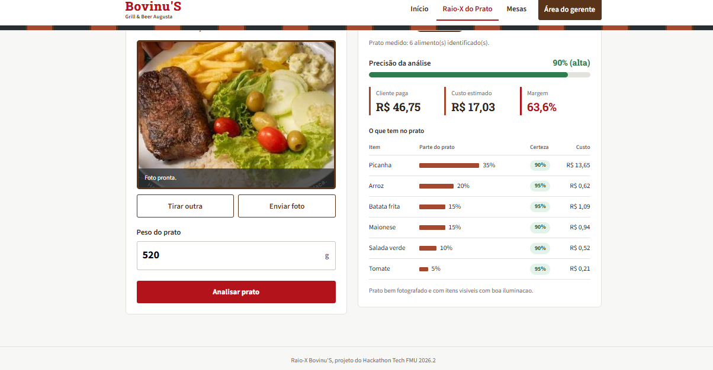
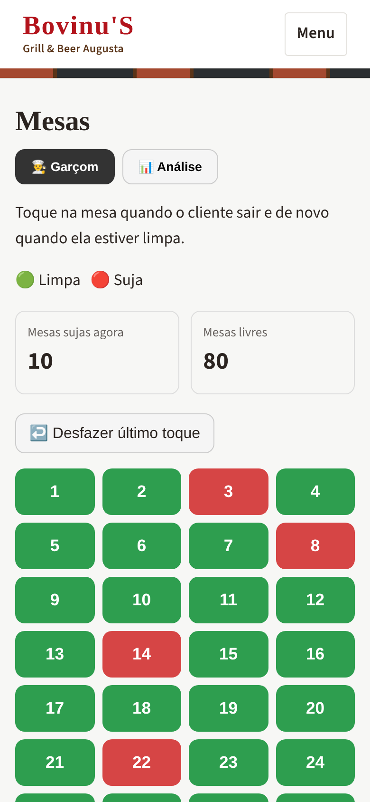
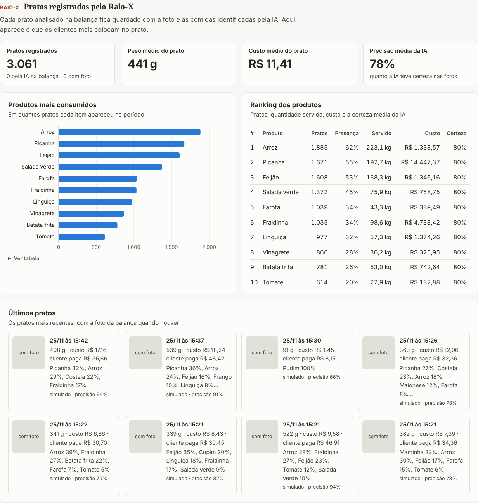
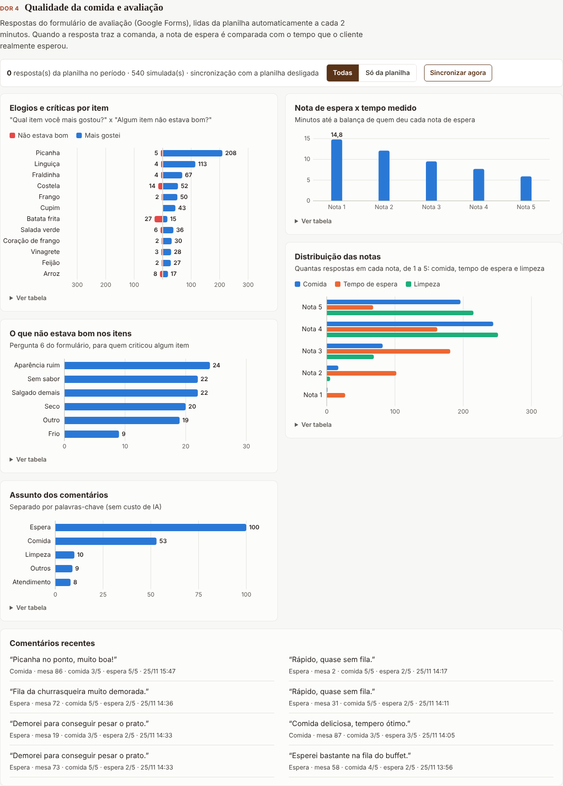
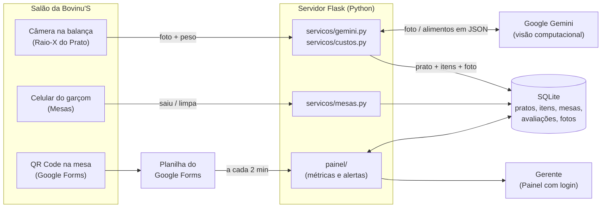
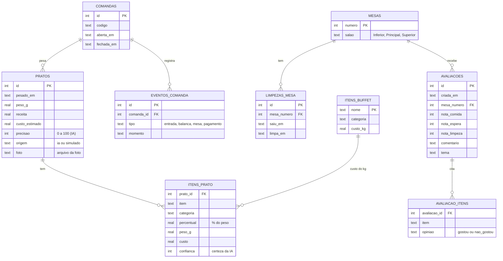

# Raio-X Bovinu'S

> **Hackathon Tech FMU 2026.2** · Desafio **Bovinu'S Grill & Beer - Augusta**

**A Bovinu'S sabe quanto cada prato pesa, mas não sabe o que foi servido, quanto tempo as mesas ficam sujas nem o que o cliente achou da comida.**
O Raio-X Bovinu'S transforma o que acontece no salão em dados: uma câmera na balança identifica cada alimento do prato com IA, o garçom marca as mesas com um toque, o cliente avalia pelo QR Code da mesa e o gerente vê tudo em um painel com alertas automáticos.

| | |
|---|---|
| **Vídeo demonstrativo (até 2 min)** | _[cole aqui o link do vídeo]_ |
| **Apresentação (5 slides)** | _[cole aqui o link ou adicione `docs/apresentacao.pdf`]_ |
| **Código-fonte** | este repositório |

## Equipe

| Integrante | Responsabilidade principal |
|---|---|
| **Lívia Moreira Teixeira** | Raio-X do Prato, integração com a IA (Gemini), integração do sistema e GitHub |
| **Lucas Freitas** | _[descreva]_ |
| **Leonardo Lima** | _[descreva]_ |

---

## 1. O desafio

Na abertura do hackathon, a Bovinu'S apresentou as dores do restaurante. O ponto em comum entre todas é que **o restaurante não tem dados sobre o salão**:

| Dor apresentada pela Bovinu'S | O que o restaurante não sabe hoje |
|---|---|
| **"Mix" do prato** | Sabe o peso, mas não o que foi servido. Ingredientes mais caros (carnes) afetam o lucro. |
| **Filas e tempo do cliente** | Quanto o cliente espera para se servir e para ser atendido na mesa. |
| **Limpeza do salão** | Quanto tempo as mesas ficam sujas depois que o cliente sai. |
| **Qualidade da comida** | O que sobra, quais comidas não saem do buffet e o que o cliente acha. |

O modelo da casa é **self-service por peso**: o cliente se serve, pesa o prato na balança e escolhe a mesa (cerca de 90 mesas em 3 salões). Os garçons servem bebidas e limpam as mesas.

## 2. A solução

Um sistema web único, que abre em qualquer computador ou celular pelo navegador, com quatro partes ligadas ao mesmo banco de dados:

### Raio-X do Prato
Uma câmera na balança fotografa o prato. A **IA do Google Gemini** identifica cada alimento, estima quanto do peso ele representa e informa a **certeza** de cada identificação e a **precisão geral** da análise. Com o peso e o custo do kg de cada item, o sistema calcula o **custo estimado e a margem do prato**. Cada prato analisado fica **registrado com a foto e as comidas** para o painel do gerente.

- Funciona com a câmera do computador ou do celular.
- A IA recebe um **guia visual do buffet** (como diferenciar arroz, feijão, farofa, picanha, fraldinha etc.) e **recusa fotos que não são de comida**.
- Usa primeiro os modelos rápidos do Gemini e troca de modelo sozinha se o Google estiver sobrecarregado.

### Controle das mesas
O garçom vê as 90 mesas no celular. Um toque marca **"cliente saiu"** (vermelha) e outro marca **"limpa"** (verde). O sistema mede o **tempo de mesa suja** por horário e por mesa, com botão de desfazer e exportação em CSV.

### Avaliação do cliente (Google Forms)
QR Code na mesa: *"Ao final da refeição, se puder, avalie sua experiência. A Bovinu'S agradece!"*. O cliente dá nota para a **comida**, o **tempo de espera** e a **limpeza**, e marca **de qual item mais gostou e qual não estava bom**. As respostas entram no painel sozinhas a cada 2 minutos.

### Painel do gerente
Área com login que junta tudo:
- **Alertas automáticos em português.** Exemplos: *"Picanha puxa o custo: é 14% do peso servido, mas 41% do custo"* ou *"Salão Superior demora a limpar"*.
- **Margem estimada do buffet**, custo médio do prato e custo da comida por kg.
- **Pratos registrados pelo Raio-X**: produtos mais consumidos, ranking, precisão média da IA e os últimos pratos com foto.
- Mix do prato (participação no peso x no custo), tempo de mesa suja por salão e horário, mapa das mesas e avaliações por item.
- Exportação em CSV para Excel ou Power BI.

### O que nos diferencia
- **A IA serve para gestão, não para cobrar.** Soluções de mercado usam visão computacional para cobrar o prato. Aqui ela mostra **onde está o custo do buffet**.
- **Os dados vêm da rotina, sem ninguém digitar planilhas**: a foto na balança, um toque do garçom, o QR Code na mesa.
- **O sistema diz o que fazer**: os alertas transformam números em decisões (reforçar a limpeza num salão, revisar um prato criticado, acompanhar o item que pesa no custo).

## 3. Capturas de tela

| | |
|---|---|
|  **Raio-X do Prato:** alimentos, certeza da IA, custo e margem |  **Mesas no celular do garçom** |
|  **Painel do gerente:** alertas automáticos e números do salão |  **Pratos registrados:** produtos mais consumidos e últimos pratos com foto |
|  **Avaliações do Google Forms** por item e por tema | |

> As telas do painel mostram **dados de demonstração** gerados pelo simulador (o próprio painel avisa isso no topo).

## 4. Arquitetura



**Fluxo do Raio-X:** a foto é reduzida no navegador (1024 px) → enviada ao Flask com o peso → o Gemini devolve os alimentos, a % do peso e a certeza de cada um → o sistema calcula `peso × % × custo do kg` de cada item → custo e margem do prato → tudo é salvo no SQLite com a foto.

## 5. Banco de dados

SQLite, em um único arquivo (`dados/bovinus.db`). Script completo em [`painel/schema.sql`](painel/schema.sql). Dicionário de dados em [`docs/painel/DICIONARIO_DE_DADOS.md`](docs/painel/DICIONARIO_DE_DADOS.md).



## 6. Tecnologias e decisões técnicas

| Tecnologia | Por quê |
|---|---|
| **Python + Flask** | Leve, rápido de desenvolver e com integração simples com APIs de IA |
| **SQLite** | Banco em um arquivo só, sem instalação: roda em qualquer computador do restaurante |
| **HTML, CSS e JavaScript** | Abre no navegador de qualquer celular ou computador, sem instalar aplicativo. A câmera funciona pelo próprio navegador |
| **Google Gemini (API REST)** | Reconhece alimentos sem precisar treinar um modelo próprio. Recebe a foto e devolve JSON em formato fixo (*response schema*) |
| **Google Forms + Planilhas** | O cliente avalia sem instalar nada. O painel lê a planilha de respostas automaticamente |
| **Gráficos em SVG puro** | O painel não depende de bibliotecas externas e funciona sem internet |

**Privacidade (LGPD):** a câmera enquadra **só o prato**, a IA é instruída a recusar fotos de pessoas, as fotos ficam no computador do restaurante (fora do GitHub) e **só o gerente logado** consegue vê-las. A avaliação do cliente é anônima.

**Segurança:** a chave da IA fica no arquivo `.env`, que **não vai para o GitHub**. Senhas do painel e chave da sessão também são configuradas pelo `.env`.

## 7. Como executar

Pré-requisito: **Python 3.10 ou mais novo**.

```bash
git clone https://github.com/moreiralivia80-oss/raio-x-bovinus
cd raio-x-bovinus
pip install -r requirements.txt
python app.py
```

1. Na primeira execução, o arquivo **`.env`** é criado sozinho na pasta do projeto.
2. Crie uma chave gratuita no [Google AI Studio](https://aistudio.google.com/apikey) e cole no `.env`:
   ```
   GEMINI_API_KEY=sua-chave-aqui
   ```
3. Rode `python app.py` de novo. O terminal deve mostrar **"IA ligada (Gemini)"**.
4. (Opcional) Para o painel abrir com 30 dias de dados de demonstração: `python -m painel.simulador`

### Endereços

| Tela | Endereço |
|---|---|
| Início | http://localhost:5000 |
| Raio-X do Prato | http://localhost:5000/raio-x |
| Mesas (garçom) | http://localhost:5000/mesas |
| Painel do gerente | http://localhost:5000/painel (usuário `gerente`, senha `bovinus2026`) |

**No celular:** use o mesmo Wi-Fi do computador e abra `http://IP-DO-COMPUTADOR:5000/raio-x`. O IP aparece no terminal na linha `Running on http://192.168...`.

### Configurações (arquivo `.env`)

| Variável | Para quê |
|---|---|
| `GEMINI_API_KEY` | Chave da IA (obrigatória para analisar fotos) |
| `PAINEL_USUARIO` / `PAINEL_SENHA` | Login do gerente |
| `SECRET_KEY` | Mantém o gerente logado mesmo depois de reiniciar o servidor |
| `PLANILHA_AVALIACOES` | Link da planilha do Google Forms (ou `desligado`) |
| `RAIOX_DEMO=1` | Ensaio sem internet: o Raio-X mostra resultados de exemplo |

> Os custos por kg dos itens e o preço de venda são **fictícios**, apenas para demonstração, e devem ser trocados pelos valores reais da Bovinu'S.

## 8. Testes

```bash
python -m unittest discover testes     # 32 testes do painel (não acessam a internet)
python diagnostico_ia.py               # testa a conexão e a chave com o Google e o tempo de cada modelo
```

Durante o desenvolvimento também testamos o Raio-X (validações, contas de custo e margem, respostas da IA em formatos inesperados, Google sobrecarregado, troca automática de modelo), a câmera no computador e no celular, a tela de mesas e a integração com o painel.

## 9. Problemas comuns

- **A IA não responde ou demora:** rode `python diagnostico_ia.py` e veja qual modelo responde e em quanto tempo.
- **Aparece "IA desligada":** a chave não está no `.env`. Cole a chave e rode `python app.py` de novo.
- **A câmera não aparece ao vivo no computador:** abra por `http://localhost:5000/raio-x`. Pelo endereço de rede, o navegador bloqueia a câmera ao vivo. Use **Enviar foto**.
- **Depois do Pull a página continua igual:** pare o servidor (Ctrl + C), rode de novo e atualize com **Ctrl + F5**.

## 10. Próximos passos

- **Integração com a balança e o PDV** da casa, para o peso entrar automaticamente.
- **Estação de leitura da comanda** (`/pipar`, já implementada): medir o tempo de fila da entrada até a balança e o tempo até o garçom atender a mesa.
- **Foto do prato devolvido** para medir as sobras e o desperdício.
- **Alerta de reposição das cubas** a partir do consumo por item e por horário.
- Custos reais por kg cadastrados pelo gerente no próprio painel.

## 11. Estrutura do repositório

```
raio-x-bovinus/
├── app.py                  # servidor Flask: páginas, Raio-X e registro dos pratos
├── servicos/
│   ├── gemini.py           # análise da foto com a IA (guia do buffet, troca de modelo)
│   ├── custos.py           # custo de cada item, custo e margem do prato
│   └── mesas.py            # tela de mesas do garçom
├── painel/                 # painel do gerente (login, métricas, alertas, Google Forms, simulador)
├── templates/              # páginas do site (base.html tem o menu)
├── static/                 # CSS com a identidade visual da Bovinu'S e o JavaScript da câmera
├── testes/                 # testes do painel
├── docs/painel/            # documentação técnica e dicionário de dados do painel
├── assets/prints/          # capturas de tela
├── diagnostico_ia.py       # teste de conexão com a IA
├── .env.example            # modelo do arquivo de configuração (sem chave)
└── requirements.txt
```
