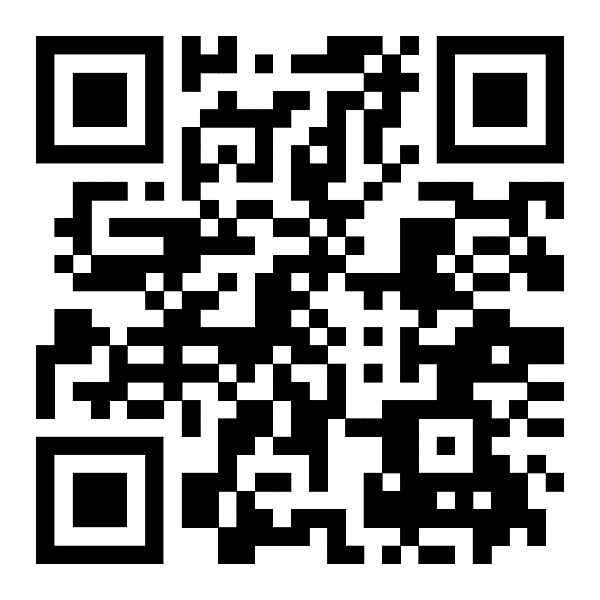
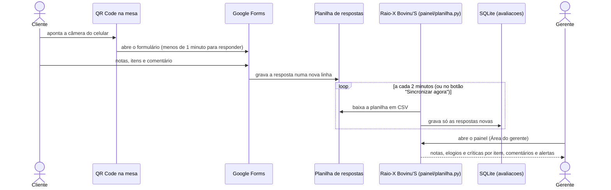
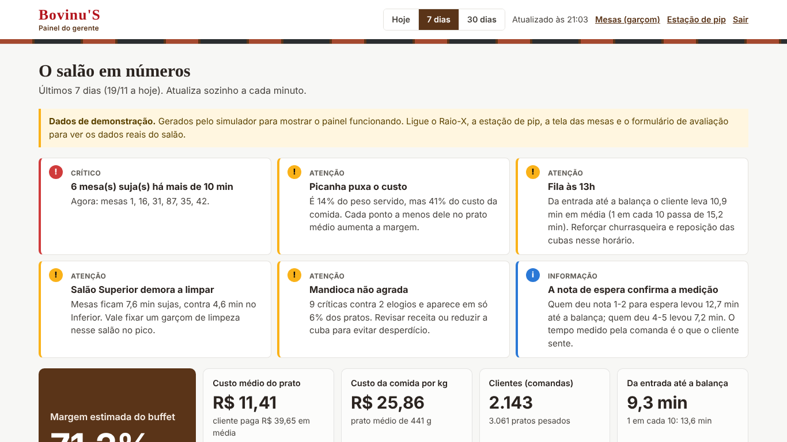
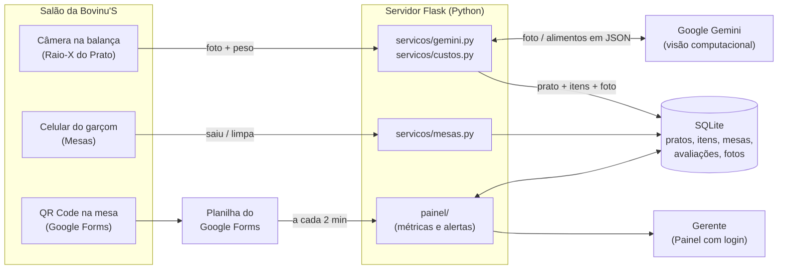

# Raio-X Bovinu'S

> **Hackathon Tech FMU 2026.2** · Desafio **Bovinu'S Grill & Beer - Augusta**

**A Bovinu'S sabe quanto cada prato pesa, mas não sabe o que foi servido, quanto tempo as mesas ficam sujas nem o que o cliente achou da comida.**
O Raio-X Bovinu'S transforma o que acontece no salão em dados: uma câmera na balança identifica cada alimento do prato com IA, o garçom marca as mesas com um toque, o cliente avalia pelo QR Code da mesa e o gerente vê tudo em um painel com alertas automáticos.

> [!NOTE]
> **Este é um protótipo funcional (MVP)**, construído nas 48 horas do hackathon para validar a ideia com a Bovinu'S. Ele **vai ser alterado e evoluído**: funciona no **computador e no celular**, e pode ficar **muito mais detalhado e preciso** com um **período de homologação** no restaurante, com dados reais do salão e **ajustes guiados pelo feedback dos donos e da equipe**. Veja a [seção 12](#12-do-protótipo-à-operação-homologação-e-próximos-passos).

| | |
|---|---|
| **Vídeo demonstrativo (até 2 min)** | _[cole aqui o link do vídeo]_ |
| **Apresentação (5 slides)** | [Slides do Raio-X Bovinu'S](https://claude.ai/artifact/Q4DQye1yDdBSmKDkxt4gNb) |
| **Código-fonte** | este repositório |

## Equipe

| Integrante | Responsabilidade principal |
|---|---|
| **Lívia Moreira Teixeira** | Raio-X do Prato, integração com a IA (Gemini), integração do sistema e GitHub |
| **Lucas Freitas** | Controle de limpeza das mesas: tela do garçom, desfazer, análise do tempo de mesa suja e exportação em CSV |
| **Leonardo Lima** | Painel do gerente completo: login, métricas e alertas automáticos, leitura do Google Forms, estação de pip da comanda e simulador de dados |

---

## Sumário

- [1. O desafio](#1-o-desafio)
- [2. A solução](#2-a-solução)
- [3. Avaliação do cliente: QR Code e Google Forms](#3-avaliação-do-cliente-qr-code-e-google-forms)
- [4. Funciona no celular](#4-funciona-no-celular)
- [5. Capturas de tela](#5-capturas-de-tela)
- [6. Arquitetura](#6-arquitetura)
- [7. Banco de dados](#7-banco-de-dados)
- [8. Tecnologias e decisões técnicas](#8-tecnologias-e-decisões-técnicas)
- [9. Como executar](#9-como-executar)
- [10. Testes](#10-testes)
- [11. Problemas comuns](#11-problemas-comuns)
- [12. Do protótipo à operação: homologação e próximos passos](#12-do-protótipo-à-operação-homologação-e-próximos-passos)
- [13. Estrutura do repositório](#13-estrutura-do-repositório)
- [Agradecimentos](#agradecimentos)

## 1. O desafio

Na abertura do hackathon, a Bovinu'S apresentou as dores do restaurante. O ponto em comum entre todas é que **o restaurante não tem dados sobre o salão**:

| Dor apresentada pela Bovinu'S | O que o restaurante não sabe hoje |
|---|---|
| **"Mix" do prato** | Sabe o peso, mas não o que foi servido. Ingredientes mais caros (carnes) afetam o lucro. |
| **Filas e tempo do cliente** | Quanto o cliente espera para se servir e para ser atendido na mesa. |
| **Limpeza do salão** | Quanto tempo as mesas ficam sujas depois que o cliente sai. |
| **Qualidade da comida** | O que sobra, quais comidas não saem do buffet e o que o cliente acha. |

O modelo da casa é **self-service por peso**: o cliente se serve, pesa o prato na balança e escolhe a mesa (cerca de 90 mesas em 3 salões). Os garçons servem bebidas e limpam as mesas.

## 2. A solução

Um sistema web único, que abre em qualquer computador ou celular pelo navegador, com quatro partes ligadas ao mesmo banco de dados:

### Raio-X do Prato
Uma câmera na balança fotografa o prato. A **IA do Google Gemini** identifica cada alimento, estima quanto do peso ele representa e informa a **certeza** de cada identificação e a **precisão geral** da análise. Com o peso e o custo do kg de cada item, o sistema calcula o **custo estimado e a margem do prato**. Cada prato analisado fica **registrado com a foto e as comidas** para o painel do gerente.

- Funciona com a câmera do computador ou do celular.
- A IA recebe um **guia visual do buffet** (como diferenciar arroz, feijão, farofa, picanha, fraldinha etc.) e **recusa fotos que não são de comida**.
- Usa primeiro os modelos rápidos do Gemini e troca de modelo sozinha se o Google estiver sobrecarregado.

### Controle das mesas
O garçom vê as 90 mesas no celular. Um toque marca **"cliente saiu"** (vermelha) e outro marca **"limpa"** (verde). O sistema mede o **tempo de mesa suja** por horário e por mesa, com botão de desfazer e exportação em CSV.

### Avaliação do cliente (QR Code + Google Forms)
Cada mesa tem um **QR Code** com a mensagem *"Ao final da refeição, se puder, avalie sua experiência. A Bovinu'S agradece!"*. Ele abre um **Google Forms** no celular do cliente, sem instalar nada. O cliente dá nota para a **comida**, o **tempo de espera** e a **limpeza**, e marca **de quais itens mais gostou e qual não estava bom**. As respostas caem numa planilha do Google, e o painel do gerente lê essa planilha sozinho a cada 2 minutos. Explicação completa na [seção 3](#3-avaliação-do-cliente-qr-code-e-google-forms).

### Painel do gerente
Área com login que junta tudo:
- **Alertas automáticos em português.** Exemplos: *"Picanha puxa o custo: é 14% do peso servido, mas 41% do custo"* ou *"Salão Superior demora a limpar"*.
- **Margem estimada do buffet**, custo médio do prato e custo da comida por kg.
- **Pratos registrados pelo Raio-X**: produtos mais consumidos, ranking, precisão média da IA e os últimos pratos com foto.
- Mix do prato (participação no peso x no custo), tempo de mesa suja por salão e horário, mapa das mesas e avaliações por item.
- Exportação em CSV para Excel ou Power BI.

### O que nos diferencia
- **A IA serve para gestão, não para cobrar.** Soluções de mercado usam visão computacional para cobrar o prato. Aqui ela mostra **onde está o custo do buffet**.
- **Os dados vêm da rotina, sem ninguém digitar planilhas**: a foto na balança, um toque do garçom, o QR Code na mesa.
- **O sistema diz o que fazer**: os alertas transformam números em decisões (reforçar a limpeza num salão, revisar um prato criticado, acompanhar o item que pesa no custo).

## 3. Avaliação do cliente: QR Code e Google Forms

É assim que a opinião de cada cliente chega ao gerente.

<p align="center"></p>

| | |
|---|---|
| **QR Code (vai em cada mesa)** | [`assets/qrcode-avaliacao.png`](assets/qrcode-avaliacao.png), que abre o formulário |
| **Formulário (o que o cliente vê)** | [Como foi sua experiência na Bovinu'S?](https://docs.google.com/forms/d/e/1FAIpQLSf2jxQKY8YI2Gnoww9kzohfGfKNzp3PTugP1MecZRGB6oZxuQ/viewform) |
| **Planilha de respostas (o que o sistema lê)** | [Respostas do formulário](https://docs.google.com/spreadsheets/d/1XTmWoDvZiKXfRDBuAWlE5j5tTUdJ3kxGXqxXPjlmr0s/edit?usp=sharing) |

### O caminho de uma avaliação



### As perguntas do formulário

| # | Pergunta | Respostas | Vai para o banco como |
|---|---|---|---|
| 1 | Como você avalia a comida? | 5 Excelente a 1 Muito Ruim | `nota_comida` |
| 2 | Como você avalia o tempo de espera? (fila do buffet, da churrasqueira e atendimento na mesa) | 5 Muito Rápido a 1 Muito Demorado | `nota_espera` |
| 3 | Como você avalia a limpeza da mesa e do salão? | 5 Impecável a 1 Muito Suja | `nota_limpeza` |
| 4 | Quais itens você mais gostou hoje? | Picanha, Linguiça, Frango, Arroz, Feijão, Feijoada, Massas, Folhas, Legumes, Pudim, Frutas ou "Nenhum em especial" | `avaliacao_itens` (opinião `gostou`) |
| 5 | Algum item não estava bom? | Os mesmos itens ou "Estava tudo bom" | `avaliacao_itens` (opinião `nao_gostou`) |
| 6 | Quer nos contar mais alguma coisa? | Texto livre (opcional) | `comentario` e `tema` (comida, espera, limpeza, atendimento ou outro) |

O sistema reconhece cada coluna da planilha **pelo texto da pergunta** (por exemplo, "comida" vira `nota_comida`). Por isso o formulário pode ganhar perguntas novas, como "Mesa" ou "Número da comanda", sem mudar o código. As regras estão em [`painel/planilha.py`](painel/planilha.py).

### O que aparece no painel do gerente

- **Nota média** da comida, da espera e da limpeza, comparada com o período anterior.
- **Elogios e críticas por item:** quais pratos mais agradam e quais precisam de atenção.
- **Temas dos comentários** e os **últimos comentários** dos clientes.
- **Alertas automáticos**, por exemplo *"Mandioca não agrada: 9 críticas contra 2 elogios"*.
- Botão **"Sincronizar agora"**, para ler a planilha na hora (útil na apresentação).

### Regras para funcionar

- A planilha precisa estar em **Compartilhar → Qualquer pessoa com o link → Leitor**. Sem isso, o sistema não consegue ler as respostas.
- Cada resposta é importada **uma vez só**, mesmo que o sistema leia a planilha várias vezes.
- Para usar outra planilha: coloque o link dela em `PLANILHA_AVALIACOES` no `.env`. Para desligar a leitura: `PLANILHA_AVALIACOES=desligado`.
- Sem internet, o painel continua funcionando com as respostas que já foram importadas.
- As respostas são **anônimas**: o formulário não pede nome, e-mail nem telefone.

## 4. Funciona no celular

O sistema é um site: **abre no navegador de qualquer celular, tablet ou computador**, sem instalar aplicativo. Cada tela foi pensada para o aparelho de quem usa:

| Quem | Aparelho | Tela | Como funciona no celular |
|---|---|---|---|
| Funcionário da balança | Tablet, celular ou computador com câmera | Raio-X do Prato | "Tirar foto" abre a **câmera do próprio aparelho**; a foto é reduzida antes de enviar, para ficar rápido no 4G |
| Garçom | Celular | Mesas | Botões grandes, um toque por mesa, atualiza sozinho a cada 5 segundos |
| Cliente | O próprio celular | Avaliação (Google Forms) | Lê o QR Code da mesa com a câmera; responde em menos de 1 minuto |
| Gerente | Computador ou celular | Painel do gerente | Os gráficos e tabelas se reorganizam para telas pequenas |

**Como abrir no celular hoje (protótipo):** o celular precisa estar no **mesmo Wi-Fi** do computador que roda o sistema. Abra `http://IP-DO-COMPUTADOR:5000` (o IP aparece no terminal quando o sistema inicia).

**Na operação real:** o sistema fica publicado num servidor com endereço próprio e **HTTPS**. Assim ele abre de qualquer lugar e a câmera também aparece ao vivo dentro da página no celular (hoje, sem HTTPS, o navegador abre a câmera do aparelho para tirar a foto).

## 5. Capturas de tela

| | |
|---|---|
|  **Raio-X do Prato:** alimentos, certeza da IA, custo e margem |  **Mesas no celular do garçom** |
|  **Painel do gerente:** alertas automáticos e números do salão |  **Pratos registrados:** produtos mais consumidos e últimos pratos com foto |
|  **Avaliações do Google Forms** por item e por tema | |

> As telas do painel mostram **dados de demonstração** gerados pelo simulador (o próprio painel avisa isso no topo).

## 6. Arquitetura



**Fluxo do Raio-X:** a foto é reduzida no navegador (1024 px) → enviada ao Flask com o peso → o Gemini devolve os alimentos, a % do peso e a certeza de cada um → o sistema calcula `peso × % × custo do kg` de cada item → custo e margem do prato → tudo é salvo no SQLite com a foto.

## 7. Banco de dados

SQLite, em um único arquivo (`dados/bovinus.db`). Script completo em [`painel/schema.sql`](painel/schema.sql). Dicionário de dados em [`docs/painel/DICIONARIO_DE_DADOS.md`](docs/painel/DICIONARIO_DE_DADOS.md).


## 8. Tecnologias e decisões técnicas

| Tecnologia | Por quê |
|---|---|
| **Python + Flask** | Leve, rápido de desenvolver e com integração simples com APIs de IA |
| **SQLite** | Banco em um arquivo só, sem instalação: roda em qualquer computador do restaurante |
| **HTML, CSS e JavaScript** | Abre no navegador de qualquer celular ou computador, sem instalar aplicativo. A câmera funciona pelo próprio navegador |
| **Google Gemini (API REST)** | Reconhece alimentos sem precisar treinar um modelo próprio. Recebe a foto e devolve JSON em formato fixo (*response schema*) |
| **Google Forms + Planilhas** | O cliente avalia sem instalar nada. O painel lê a planilha de respostas automaticamente |
| **Gráficos em SVG puro** | O painel não depende de bibliotecas externas e funciona sem internet |

**Privacidade (LGPD):** a câmera enquadra **só o prato**, a IA é instruída a recusar fotos de pessoas, as fotos ficam no computador do restaurante (fora do GitHub) e **só o gerente logado** consegue vê-las. A avaliação do cliente é anônima.

**Segurança:** a chave da IA fica no arquivo `.env`, que **não vai para o GitHub**. Senhas do painel e chave da sessão também são configuradas pelo `.env`.

## 9. Como executar

Pré-requisito: **Python 3.10 ou mais novo**.

```bash
git clone https://github.com/moreiralivia80-oss/raio-x-bovinus
cd raio-x-bovinus
pip install -r requirements.txt
python app.py
```

1. Na primeira execução, o arquivo **`.env`** é criado sozinho na pasta do projeto.
2. Crie uma chave gratuita no [Google AI Studio](https://aistudio.google.com/apikey) e cole no `.env`:
   ```
   GEMINI_API_KEY=sua-chave-aqui
   ```
3. Rode `python app.py` de novo. O terminal deve mostrar **"IA ligada (Gemini)"**.
4. (Opcional) Para o painel abrir com 30 dias de dados de demonstração: `python -m painel.simulador`

### Caminhos do sistema (endereços)

Todos começam com `http://localhost:5000` no computador, ou com `http://IP-DO-COMPUTADOR:5000` no celular (mesmo Wi-Fi; o IP aparece no terminal na linha `Running on http://192.168...`).

**Páginas**

| Caminho | Página | Quem usa |
|---|---|---|
| `/` | Início, com o menu | Todos |
| `/raio-x` | Raio-X do Prato: foto + peso → alimentos, certeza da IA, custo e margem | Funcionário da balança |
| `/mesas` | Mesas: cliente saiu (vermelha) / limpa (verde), desfazer e análise | Garçom (celular) |
| `/painel` | Painel do gerente (pede login: usuário `gerente`, senha `bovinus2026`) | Gerente |
| `/painel/login` e `/painel/sair` | Entrar e sair da área do gerente | Gerente |
| `/garcom` | Mesas do painel: funciona sem internet, desfazer por 2 minutos | Garçom (alternativa) |
| `/pipar` | Estação de leitura da comanda: entrada, balança, mesa e caixa (próximo passo: medir a fila) | Funcionários |
| [Google Forms](https://docs.google.com/forms/d/e/1FAIpQLSf2jxQKY8YI2Gnoww9kzohfGfKNzp3PTugP1MecZRGB6oZxuQ/viewform) | Avaliação, aberta pelo QR Code da mesa | Cliente |

`/gerente` e `/gerente/login` são endereços antigos e levam ao painel.

**API (usada pelas páginas)**

| Método e caminho | O que faz |
|---|---|
| `POST /api/raio-x/analisar` | Recebe a foto e o peso, chama a IA, calcula custo e margem e registra o prato |
| `GET /api/mesas/estado` · `POST /api/mesas/<n>/alternar` · `POST /api/mesas/desfazer` | Tela de mesas: situação, marcar suja/limpa e desfazer |
| `GET /api/mesas/resumo` · `GET /api/mesas/exportar.csv` | Análise das mesas e exportação em CSV |
| `GET /api/painel/dados?dias=7` | Tudo o que o painel mostra, em JSON (gerente) |
| `POST /api/painel/sincronizar` | Lê a planilha do Google Forms na hora (gerente) |
| `GET /api/painel/exportar/<tabela>.csv` | Tabelas do banco em CSV para Excel ou Power BI (gerente) |
| `GET /painel/foto/<id>` | Foto de um prato registrado (só o gerente logado) |
| `POST /api/comanda/pipar` · `POST /api/avaliacoes` · `POST /api/pratos` | Entradas extras do painel: comanda, avaliação e prato por outros sistemas |

### Configurações (arquivo `.env`)

| Variável | Para quê |
|---|---|
| `GEMINI_API_KEY` | Chave da IA (obrigatória para analisar fotos) |
| `PAINEL_USUARIO` / `PAINEL_SENHA` | Login do gerente |
| `SECRET_KEY` | Mantém o gerente logado mesmo depois de reiniciar o servidor |
| `PLANILHA_AVALIACOES` | Link da planilha do Google Forms (ou `desligado`) |
| `RAIOX_DEMO=1` | Ensaio sem internet: o Raio-X mostra resultados de exemplo |

> Os custos por kg dos itens e o preço de venda são **fictícios**, apenas para demonstração, e devem ser trocados pelos valores reais da Bovinu'S.

## 10. Testes

```bash
python -m unittest discover testes     # 32 testes do painel (não acessam a internet)
python diagnostico_ia.py               # testa a conexão e a chave com o Google e o tempo de cada modelo
```

Durante o desenvolvimento também testamos o Raio-X (validações, contas de custo e margem, respostas da IA em formatos inesperados, Google sobrecarregado, troca automática de modelo), a câmera no computador e no celular, a tela de mesas e a integração com o painel.

## 11. Problemas comuns

- **A IA não responde ou demora:** rode `python diagnostico_ia.py` e veja qual modelo responde e em quanto tempo.
- **Aparece "IA desligada":** a chave não está no `.env`. Cole a chave e rode `python app.py` de novo.
- **A câmera não aparece ao vivo no computador:** abra por `http://localhost:5000/raio-x`. Pelo endereço de rede, o navegador bloqueia a câmera ao vivo. Use **Enviar foto**.
- **Depois do Pull a página continua igual:** pare o servidor (Ctrl + C), rode de novo e atualize com **Ctrl + F5**.

## 12. Do protótipo à operação: homologação e próximos passos

O que está neste repositório é um **protótipo**: ele prova que a ideia funciona de ponta a ponta, mas foi feito em 48 horas, com custos fictícios e dados de demonstração. O caminho para virar uma ferramenta do dia a dia da Bovinu'S é este:

### Fase 1: protótipo (hackathon), concluída
Raio-X do Prato com IA, controle das mesas, avaliação pelo QR Code e painel do gerente funcionando juntos, no computador e no celular.

### Fase 2: homologação no restaurante
Usar o sistema **em paralelo à rotina do salão**, por algumas semanas, para medir e ajustar sem atrapalhar a operação:
- **Custos reais** de cada item do buffet e o preço real do kg no lugar dos valores fictícios.
- **Calibrar a IA com fotos reais** dos pratos da casa: ajustar o guia visual do buffet aos pratos e às cubas da Bovinu'S e conferir a identificação com a balança.
- **Alinhar os nomes** dos itens entre o formulário do cliente e o Raio-X, para cruzar "o que o cliente comeu" com "o que ele achou".
- **Criar a linha de base** do restaurante: margem por prato, tempo de mesa suja por salão e horário, notas dos clientes. Com o tempo, o painel fica **muito mais detalhado**: compara semanas, horários de pico e dias da semana.
- **Treinar a equipe** (balança, garçons e gerência) e ajustar o fluxo de cada tela ao que eles realmente fazem no salão.

### Fase 3: ajustes com o feedback dos donos e da equipe
O que o painel mostra, quais alertas importam e em que ordem, e quais relatórios o gerente precisa vêm **das conversas com os donos e com a equipe** durante a homologação. O protótipo foi construído para ser alterado: telas, alertas, perguntas do formulário e categorias podem mudar sem refazer o sistema.

### Fase 4: evolução
- **Integração com a balança e o PDV** da casa, para o peso entrar automaticamente.
- **Leitura da comanda** (`/pipar`, já implementada): medir o tempo de fila da entrada até a balança e o tempo até o garçom atender a mesa.
- **Um QR Code por mesa** (link pré-preenchido do Google Forms com o número da mesa), para cruzar a nota do cliente com o tempo de limpeza daquela mesa.
- **Foto do prato devolvido** para medir as sobras e o desperdício.
- **Alerta de reposição das cubas** a partir do consumo por item e por horário.
- **Publicação em servidor com HTTPS**, login individual por funcionário e cadastro de custos pelo próprio painel.
- Levar o modelo para **outras unidades da rede Bovinu'S**, comparando os resultados entre elas.

### Limitações conhecidas do protótipo
- Custos por kg e preço de venda são **fictícios**.
- O plano gratuito do Gemini pode **demorar ou ficar sobrecarregado** em alguns horários (o sistema tenta de novo e troca de modelo sozinho, mas a resposta pode levar alguns segundos).
- Roda no computador da equipe e abre no celular **pela mesma rede Wi-Fi**; ainda não está publicado na internet.
- O login do painel é **um usuário só**, para demonstração.
- As telas do painel nas capturas usam **dados de demonstração** do simulador.

## 13. Estrutura do repositório

```
raio-x-bovinus/
├── app.py                  # servidor Flask: páginas, Raio-X e registro dos pratos
├── servicos/
│   ├── gemini.py           # análise da foto com a IA (guia do buffet, troca de modelo)
│   ├── custos.py           # custo de cada item, custo e margem do prato
│   └── mesas.py            # tela de mesas do garçom
├── painel/                 # painel do gerente (login, métricas, alertas, Google Forms, simulador)
├── templates/              # páginas do site (base.html tem o menu)
├── static/                 # CSS com a identidade visual da Bovinu'S e o JavaScript da câmera
├── testes/                 # testes do painel
├── docs/painel/            # documentação técnica e dicionário de dados do painel
├── assets/prints/          # capturas de tela
├── assets/qrcode-avaliacao.png  # QR Code da avaliação (vai em cada mesa)
├── diagnostico_ia.py       # teste de conexão com a IA
├── .env.example            # modelo do arquivo de configuração (sem chave)
└── requirements.txt
```

## Agradecimentos

À **Bovinu'S Grill & Beer - Augusta**, por abrir os desafios reais do restaurante, à **FMU** pela organização do Hackathon Tech 2026.2 e aos mentores pelas orientações durante o evento.
