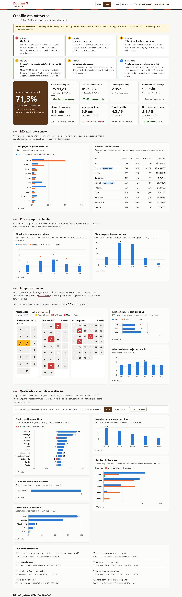
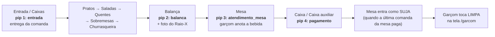
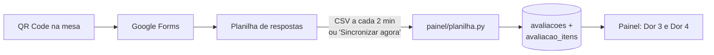
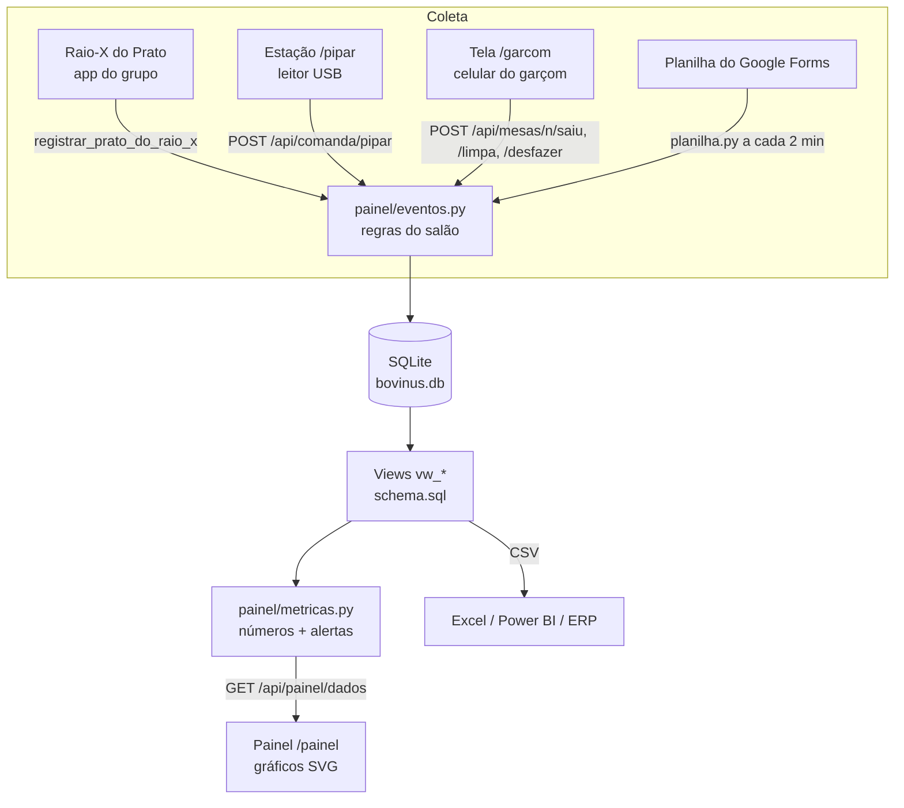

# Como o Painel Gerencial foi desenvolvido

> Projeto Raio-X Bovinu'S · Hackathon Tech FMU 2026.2 · parte: **Painel do gerente**

## 1. Objetivo

Na apresentação, a Bovinu'S mostrou quatro dores com um ponto em comum: **não existe dado sobre o que acontece no salão**. O objetivo do painel é transformar o que já acontece no salão (pesar o prato, pagar, limpar a mesa, responder a pesquisa) em números confiáveis, **sem trabalho extra para a equipe** e com custo baixo.

Três princípios guiaram as decisões:

1. **Automático.** Cada número nasce de um gesto que o funcionário ou o cliente já faz (passar a comanda, pesar, tocar "limpa", responder o formulário). Ninguém digita relatório.
2. **Objetivo.** Tempo medido no relógio, não na percepção. A percepção do cliente (nota) aparece ao lado, para ser comparada.
3. **Consumível.** Os dados ficam em tabelas simples e views SQL, exportáveis em CSV, para entrar no sistema que a casa já usa.

## 2. Da dor ao número

| Dor da Bovinu'S | Pergunta do gerente | Dado coletado | Como é medido | Onde aparece |
|---|---|---|---|---|
| i. Mix do prato | Quanto custa o prato que eu vendo? Qual item come a margem? | Foto + peso do prato | Raio-X (IA) devolve o % de cada item; peso × % × custo/kg | Margem (destaque), custo médio, "peso x custo", tabela de itens |
| ii. Filas e tempo | Quanto o cliente espera para se servir? E pelo garçom? | Pip da comanda na entrada, na balança e pelo garçom | balança − entrada; garçom − balança | "Da entrada até a balança", gráficos por hora |
| iii. Limpeza | Quanto tempo a mesa fica suja? | Pagamento da última comanda da mesa (ou toque do garçom) e toque "limpa" na tela do garçom; nota de limpeza da pesquisa | limpa − saiu | Mapa ao vivo, por salão, por horário, nota de limpeza |
| iv. Qualidade | O que o cliente achou? O que não sai do buffet? | Pesquisa do Google Forms (planilha) + presença do item nos pratos | Elogios e críticas por item; motivo da crítica; % de pratos com o item; assunto do comentário | Elogios x críticas, motivos, "pouca saída", notas |

## 3. A ideia da comanda "pipada"

Para medir a espera, a comanda é **entregue no começo do atendimento e lida (pipada) nos pontos por onde o cliente já passa**. Cada leitura vira uma linha na tabela `eventos_comanda`.

O que cada intervalo mede:

| Intervalo | Responde |
|---|---|
| entrada → 1ª balança | tempo para se servir (fila do buffet + churrasqueira + reposição das cubas) |
| 1ª balança → garçom na mesa | "tempo para ser atendido na mesa" (slide das dores) |
| entrada → pagamento | permanência total |
| saiu → limpa | tempo de mesa suja |

**Por que é barato:** a comanda já existe; basta imprimir um código de barras nela. Um leitor USB custa na faixa de R$ 80 a R$ 150 e funciona como teclado (digita o número e aperta Enter). Por isso a estação `/pipar` é só uma página web com um campo de texto. Sem leitor, o funcionário digita o número.

**Regras do salão (em `painel/eventos.py`):**

| Situação | O que o sistema faz |
|---|---|
| Última comanda aberta da mesa é paga | A mesa entra sozinha como suja (`origem = 'caixa'`). Se o grupo tem outras comandas abertas naquela mesa, espera a última. |
| Leitor lê a mesma comanda 2 vezes no mesmo ponto em até 60 s | Considera leitura repetida e não conta de novo. Um 2º prato, minutos depois, conta normalmente. |
| Garçom pipa um cliente numa mesa que ainda estava "suja" | Libera a mesa (`limpa_origem = 'novo_cliente'`). Esse ciclo fica fora das médias de limpeza. |
| Mesa marcada suja e limpa só mais de 90 min depois | Tempo considerado "esquecido": não entra nas médias e gera um alerta próprio. |
| Garçom tocou errado | "Desfazer" até 2 minutos depois. |
| Comanda aberta há mais de 12 h | Considerada esquecida: um novo pip abre outro uso do cartão. |
| Mesa "ocupada" no mapa | Há comanda aberta ligada a ela nas últimas 6 h. |

## 4. Funcionamento sem conexão

O salão tem Wi-Fi instável e o computador pode desligar. A tela do garçom e a estação de pip usam uma **fila no próprio aparelho** (`static/painel/fila.js`):

1. Com conexão, o toque vai na hora e o servidor usa o relógio **dele**: todos os pontos ficam com a mesma hora.
2. Sem conexão, o toque fica guardado no aparelho **com a hora do toque** e a tela avisa "Sem conexão: N guardado(s)".
3. A cada 10 segundos (e quando o aparelho volta à rede), a fila é reenviada.
4. Cada toque leva um identificador único (`id_cliente`): se a resposta se perder e o toque for reenviado, o servidor reconhece e não conta duas vezes.
5. Um toque guardado ainda pode ser desfeito: o "Desfazer" só o tira da fila.

Testado: com o servidor desligado, dois toques de mesa e um pagamento ficaram guardados; ao religar, foram gravados com a hora dos toques, e a mesa ficou suja sozinha pelo pagamento.

**Limite:** sem o servidor, a página não pode ser **recarregada** (o navegador não tem de onde buscá-la). O recurso que permitiria isso (*service worker*) exige HTTPS, e o celular acessa por `http://IP`. Os toques guardados não se perdem: são enviados quando a página voltar a abrir.

## 5. Pesquisa do cliente (Google Forms)

O grupo fez a pesquisa no Google Forms, e as respostas vão para uma planilha. O painel **lê a planilha sozinho a cada 2 minutos** (`painel/planilha.py`), sem ninguém exportar nada:

Como cada pergunta é reconhecida (pelo texto, sem acento e sem diferenciar maiúsculas):

| Pergunta do formulário | Campo no banco | Tratamento |
|---|---|---|
| Carimbo de data/hora | `criada_em` | `25/11/2026 19:43:08` → `2026-11-25 19:43:08`; também é a chave que impede importar a mesma resposta 2 vezes |
| 1. Como você avalia a comida? | `nota_comida` | `5 - Excelente` → 5 |
| 2. Como você avalia o tempo de espera? | `nota_espera` | `4 - Rápido` → 4 |
| 3. Como você avalia a limpeza da mesa e do salão? | `nota_limpeza` | `2 - Suja` → 2 |
| 4. Quais itens você mais gostou hoje? | `avaliacao_itens` (gostou) | `Churrasco: Picanha, Prato quente: Arroz` → Picanha, Arroz |
| 5. Algum item não estava bom? | `avaliacao_itens` (nao_gostou) | `Estava tudo bom` → nenhum item |
| 6. O que não estava bom nesses itens? | `motivo` | só é gravado quando algum item foi criticado |
| 7. Quer nos contar mais alguma coisa? | `comentario` + `tema` | assunto por palavras-chave (comida, espera, limpeza, atendimento, outro) |

Também são reconhecidas, se o grupo acrescentar ao formulário: **mesa**, **comanda** e **desconto/cashback**.

Conferido linha a linha contra as 9 primeiras respostas reais da planilha (25/11/2026): todas as notas, itens e motivos foram gravados como na planilha, e uma 2ª leitura não duplicou nada. No painel, o botão **"Só da planilha"** mostra apenas as respostas reais, sem as simuladas.

**O que o formulário ainda não pergunta:** a mesa e a comanda. Sem elas, a resposta não se liga ao tempo medido, e o gráfico "Nota de espera x tempo medido" fica vazio para as respostas reais (ele avisa isso na tela). Ver a sugestão no [AVALIACAO_DO_PROJETO.md](AVALIACAO_DO_PROJETO.md#5-como-integrar-o-painel-no-zip).

## 6. Arquitetura

| Peça | Escolha | Por quê |
|---|---|---|
| Servidor | **Flask Blueprint**; no .exe, servidor **Waitress** | O app do grupo já é Flask. O painel entra com 2 linhas (`register_blueprint`) ou roda sozinho. O Waitress não tem o depurador do Flask, que exposto na rede deixaria executar código no computador. |
| Banco | **SQLite** em modo WAL | Um arquivo, zero instalação. O WAL deixa o painel ler enquanto o caixa grava (testado com 60 pips simultâneos). Bancos de versões anteriores ganham as colunas novas sozinhos (`banco._migrar`). |
| Cálculo | **SQL (views) + Python puro** | As views são o contrato de dados: o restaurante consome a mesma lógica que o painel usa. Sem pandas, o projeto depende só de Flask e Waitress. |
| Gráficos | **SVG desenhado em JavaScript puro** | Sem biblioteca nem CDN: funciona sem internet. |
| Assunto do comentário | **Palavras-chave** | Custo zero de API. A coluna `tema` aceita a classificação do Gemini, se o grupo quiser usar. |
| Pesquisa | **Leitura do CSV público da planilha** | Não precisa de chave de API do Google nem de login, só que a planilha esteja como "Qualquer pessoa com o link: Leitor". |
| Executável | **PyInstaller** (um arquivo, ~12 MB) | Roda em qualquer Windows sem instalar Python. |

O resumo original citava pandas para os cálculos. A troca por views SQL foi intencional: o mesmo cálculo serve ao painel e ao sistema da casa, e o projeto fica com menos dependências.

## 7. Identidade visual

O painel segue a identidade do app do grupo (`static/css/style.css` do zip):

| Igual ao app | Diferente | Motivo |
|---|---|---|
| Cores da fachada: vermelho `#B3141C`, tijolo `#A4492F`, madeira `#5A3418`, fachada `#F7F7F5`, concreto, vidro | Fonte do texto: **Segoe UI** (o app usa Source Sans 3) | Legibilidade avaliada pelo grupo e funcionamento sem internet. A fonte serifada (Roboto Slab) ficou no letreiro e nos títulos. |
| Cabeçalho branco, letreiro "Bovinu'S", faixa de pilares de tijolo | Medidas: cabeçalho 68px (app 72), letreiro 1,6rem (1,75), faixa 8px (10), página 1280px (1120) | Mais largura para os gráficos. |
| Caixa de login com borda de madeira e botão vermelho | Gráficos em azul e laranja; amarelo, laranja e vermelho só para estado (mesa suja, alertas) | Paleta que funciona para daltônicos; cor de estado nunca é usada como cor de série. |
| — | O painel não mostra o menu do app (Início, Raio-X, Mesas) | Ao integrar, acrescentar o link de volta ao app (ver avaliação do projeto). |

## 8. Etapas do desenvolvimento

1. **Leitura do projeto do grupo.** O app Flask já tinha o Raio-X funcionando (foto → Gemini → custo e margem), mas o resultado não era salvo; Avaliação, Mesas e Área do gerente eram páginas reservadas. Conclusão: faltava a **camada de dados**.
2. **Modelagem.** Uma tabela por acontecimento do salão, com datas em texto `AAAA-MM-DD HH:MM:SS` (legível no Excel), e uma view (`vw_*`) para cada pergunta do gerente. Ver [DICIONARIO_DE_DADOS.md](DICIONARIO_DE_DADOS.md).
3. **Regras de gravação** (`eventos.py`): as do quadro da seção 3.
4. **Simulador** (`simulador.py`): sem dado real, foi criado um gerador com o comportamento esperado do salão, para provar o painel e calibrar os alertas.
5. **Métricas e alertas** (`metricas.py`): uma função monta todo o painel para o período (hoje, 7 ou 30 dias) e compara com o período anterior do mesmo tamanho.
6. **Interface**: painel, login e estação de pip, na identidade do app (seção 7).
7. **Executável** (`iniciar_painel.py` + `gerar_executavel.ps1`): cria o banco ao lado do .exe, mostra os endereços para celular, abre o navegador e usa o Waitress. As opções `--vazio` e `--demo` nunca apagam dados reais.
8. **Revisão de legibilidade**: fonte do sistema, letras maiores, mais contraste e layout para celular.
9. **Teste de todos os caminhos** e correções: leitura dupla, mesa esquecida, mesa inexistente, fórmula do Excel no CSV.
10. **Pesquisa real** (`planilha.py`): leitura automática da planilha do Google Forms, nota de limpeza, motivo da crítica, filtro "Só da planilha".
11. **Mesas conectadas** (`/garcom`) e **funcionamento sem conexão** (`fila.js`).

## 9. Fórmulas

| Número | Fórmula |
|---|---|
| Receita do prato | peso (kg) × preço do kg |
| Custo do item | peso do prato × % do item (Raio-X) × custo do kg do item |
| Custo do prato | soma dos custos dos itens |
| **Margem estimada** | (Σ receita − Σ custo) ÷ Σ receita no período (ponderada pelo peso, não é a média das margens) |
| Custo da comida por kg | Σ custo ÷ Σ peso |
| % do peso / % do custo do item | peso (ou custo) do item ÷ total do período |
| Presença | pratos com o item ÷ total de pratos |
| Da entrada até a balança | 1ª balança − entrada da comanda (média e "1 em cada 10", o percentil 90) |
| Garçom chega à mesa | pip do garçom − 1ª balança |
| Mesa suja até limpar | limpa − saiu, **só** ciclos em que o garçom tocou "limpa" e que duraram até 90 min |
| Notas (comida, espera, limpeza) | média das respostas de 1 a 5 |
| Taxa de resposta | avaliações ÷ comandas do período |

O "1 em cada 10" (percentil 90) aparece junto da média de propósito: a média esconde o cliente que esperou muito, e é ele quem dá nota baixa.

## 10. Alertas automáticos

O painel não espera o gerente achar o problema: regras simples viram frases no topo da tela.

| Regra | Dispara quando | Exemplo (dados de demonstração) |
|---|---|---|
| Item que puxa o custo | % do custo − % do peso > 5 p.p. | "Picanha é 14% do peso servido, mas 41% do custo" |
| Fila por horário | média até a balança ≥ 8 min (crítico ≥ 11) numa hora com 10+ clientes | "Fila às 13h: 11,1 min; 1 em cada 10 passa de 15,5 min" |
| Salão lento para limpar | diferença entre salões ≥ 1,5 min | "Salão Superior: 7,5 min contra 4,4 no Inferior" |
| Mesa suja agora | suja entre 10 e 90 min | "6 mesas sujas há mais de 10 min" |
| Mesa esquecida | suja há mais de 90 min | "provavelmente já foram limpas e ninguém tocou 'limpa'" |
| Item que não agrada | 5+ críticas; o de maior proporção crítica/elogio | "Mandioca: 10 críticas contra 1 elogio, aparece em 7% dos pratos" |
| Nota x medição | quem deu nota de espera 1-2 esperou 2+ min a mais que quem deu 4-5 | mostra que o tempo medido é o que o cliente sente |
| Limpeza mal avaliada | nota média de limpeza < 3,5 com 5+ respostas | "Nota média de limpeza da mesa e do salão: (nota) de 5" |
| Margem | variação ≥ 1 p.p. contra o período anterior | "Margem estimada de (x)%, (y) p.p. abaixo do período anterior" |

## 11. Dados de demonstração

Enquanto não há dado real do salão, o simulador gera 30 dias (`python -m painel.simulador`, ou automaticamente na 1ª vez do .exe). Hipóteses, a ajustar com a Bovinu'S:

- almoço das 11h às 16h, pico entre 12h30 e 13h30, fim de semana com cerca de 50% a mais de clientes;
- grupos de 1 a 5 pessoas, uma comanda por pessoa, mesas dos três salões do mapa (Inferior 1-20, Principal 21-50, Superior 51-90);
- a espera até a balança cresce com o número de pessoas que entraram nos 15 minutos anteriores;
- a limpeza demora mais quando há muitas mesas sujas ao mesmo tempo e no Salão Superior (escada);
- 25% respondem a avaliação; quem espera mais dá nota de espera menor; no Salão Superior a nota de limpeza é menor; lasanha, peixe e mandioca recebem mais críticas;
- os custos por kg são os mesmos valores **fictícios** do `servicos/custos.py` do grupo.

O painel mostra a faixa amarela "Dados de demonstração" enquanto a tabela `meta` tiver `dados_simulados = 1`. As respostas simuladas ficam com `origem = 'simulado'`; as da planilha, com `origem = 'planilha'`. Por isso o filtro "Só da planilha" separa as duas mesmo dentro do banco de demonstração.

## 12. Testes

| Teste | O que cobre | Resultado (25/11/2026) |
|---|---|---|
| `python -m unittest discover testes` | 32 testes: jornada da comanda, mesa automática, leitura repetida, reenvio da fila offline, mesas (desfazer, esquecida, inexistente), Raio-X, avaliação, leitura do formulário real, filtro "só reais", atualização de banco antigo, login, CSV, rotas | 32 OK |
| `testes/ponta_a_ponta.py` (com o .exe rodando) | 77 verificações pela rede, como os aparelhos do salão: login, 14 CSVs, jornada, erros de operação, leitura dupla, grupo, mesas, Raio-X, avaliação, gravação sem login, 60 pips simultâneos | 69 OK, 2 FALHA conhecidas, 6 INFO (seção 13) |
| Navegador (manual) | banco vazio sem erro; tela do garçom e estação de pip com o servidor desligado e religado; sem internet (só a fonte dos títulos muda); celular 375px sem transbordar; 2ª cópia do .exe usa a próxima porta | OK |

## 13. Limitações conhecidas

| Ponto | Situação | O que fazer |
|---|---|---|
| Peso negativo ou absurdo em `/api/pratos` | Aceito (FALHA no teste de ponta a ponta) | Validar de 1 a 3000 g, como o Raio-X já faz na tela |
| Mesma comanda avaliando várias vezes pela API | Aceito (FALHA no teste); a planilha não tem comanda, então hoje não há como bloquear | Pedir o número da comanda no formulário e aceitar 1 benefício por comanda |
| Gravação sem login (`/pipar`, `/garcom`, APIs de gravação) | Qualquer aparelho no mesmo Wi-Fi consegue gravar | Rede separada para a equipe ou PIN da estação |
| Grupo em que o garçom pipa só uma comanda | A mesa fica suja quando essa pessoa paga, mesmo com o colega sentado | Treinar o garçom a pipar todas as comandas da mesa, ou corrigir com "Desfazer" |
| Toque guardado sem conexão | Usa o relógio do celular | Manter a hora automática ligada nos aparelhos |
| Itens do formulário fora do cadastro (ex.: Feijoada, Massas) | Aparecem nas opiniões, mas sem custo nem presença nos pratos | Usar no formulário os mesmos nomes de `itens_buffet` (ou cadastrar os itens) |
| % de cada item vem de uma foto | A IA estima área, não peso; itens densos tendem a ser subestimados | Calibrar com 20 a 30 pratos pesados item por item |
| Fila da churrasqueira | Somada à do buffet | Mais um ponto de pip na churrasqueira (novo `tipo`) |
| "Ver tabela" | Fecha sozinho na atualização de cada minuto | A revisar com o grupo |
| Banco dentro do OneDrive | A sincronização pode conflitar com o arquivo do SQLite em uso | Usar o .exe numa pasta fora do OneDrive (ex.: `C:\Bovinus`) |
| Raio-X analisado 2 vezes para o mesmo prato | Grava 2 pratos (na integração com o app do grupo) | Salvar só quando o operador confirmar o resultado |

## 14. Próximos passos

1. Acrescentar ao formulário **mesa** e **comanda** (link pré-preenchido por mesa no QR Code), para ligar a nota ao tempo real e controlar o cashback.
2. Ler o peso direto da balança (Toledo e Filizola têm saída serial) em vez de digitar.
3. Cadastro do custo por kg pelo próprio gerente (a tabela `itens_buffet` já existe).
4. Resumo diário automático por e-mail ou WhatsApp com os alertas do dia anterior.
5. Desperdício real: pesar o que volta das cubas no fim do turno e cruzar com a presença do item nos pratos.
